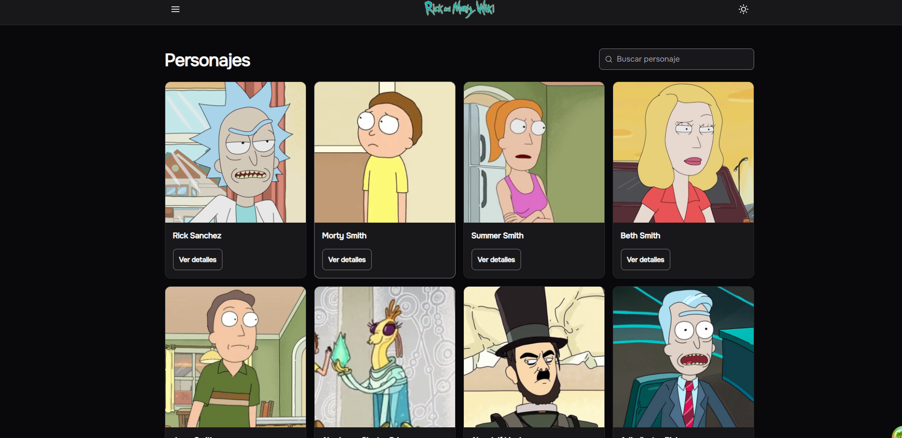

# 🛸 Rick and Morty App

A responsive Rick and Morty character explorer built with **React, Vite, JavaScript, and Tailwind CSS**. Browse characters from the series, search by name, and explore detailed character information using the Rick and Morty API.

This project demonstrates component-based frontend development, REST API integration, client-side routing, pagination, and asynchronous data fetching.

## 🌐 Live Demo

**[Explore the Rick and Morty App](https://rick-and-morty-app-two-tau.vercel.app/)**

## 📸 Screenshots

### 🏠 Home Page

An introduction to the series featuring cards for the main characters.


### 🔎 Character Explorer

Browse characters in a responsive grid, search by name, and navigate between pages.



### 👤 Character Details

View character images and information including status, species, gender, origin, and location.


## ✨ Features

- **Character Browsing:** Explore characters from the Rick and Morty universe.
- **Search by Name:** Find characters using a search input.
- **Pagination:** Navigate through multiple pages of API results.
- **Character Details:** View each character's profile, status, species, gender, origin, and location.
- **Character Navigation:** Move between character detail pages.
- **Responsive Design:** Character cards adapt to different screen sizes.
- **Client-Side Routing:** Navigate between the home page, character list, and character details.
- **API Integration:** Fetch character data from the Rick and Morty API.

## 🛠️ Tech Stack

| Technology | Purpose |
|---|---|
| React | Reusable user interface components |
| Vite | Development and production builds |
| JavaScript | Application logic |
| Tailwind CSS | Styling and responsive layouts |
| React Router | Client-side routing |
| TanStack Query | Asynchronous data fetching |
| React Paginate | Pagination controls |
| Rick and Morty API | Character data |

## 🚀 Getting Started

### 1. Clone the repository

```bash
git clone https://github.com/alvaro-sosa1432/rick-and-morty-app.git
cd rick-and-morty-app
```

### 2. Install dependencies

```bash
npm install
```

### 3. Run the development server

```bash
npm run dev
```

Open the local URL shown in your terminal.

### 4. Build for production

```bash
npm run build
```

## 📁 Project Highlights

- Working with an external REST API
- Creating reusable React components
- Implementing dynamic routes
- Keeping search and pagination state in the URL
- Building responsive character grids
- Displaying detailed data for individual characters

## 👨‍💻 About the Developer

I'm a Junior Frontend Developer focused on building modern, responsive, and interactive web applications.

I'm interested in freelance projects involving React development, responsive interfaces, landing pages, and frontend improvements.

## 📬 Contact

- **Portfolio:** https://alvaro-sosa1432.vercel.app/
- **GitHub:** https://github.com/alvaro-sosa1432
- **LinkedIn:** https://www.linkedin.com/in/alvaro-sosa1432/

---

Built with React, Vite, and Tailwind CSS. Rick and Morty characters and related content belong to their respective owners.
