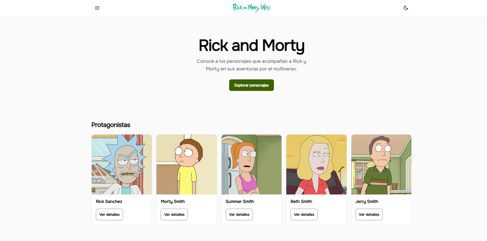
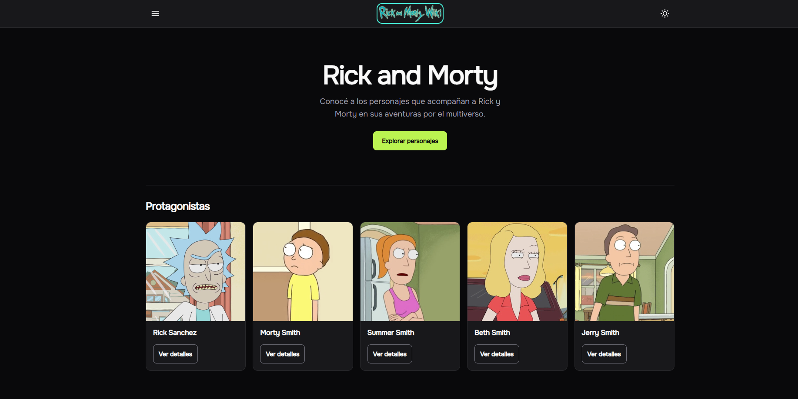
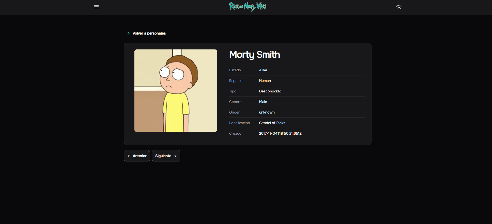

# Rick and Morty App

A responsive character explorer powered by the Rick and Morty API. Meet the main cast on the home page, search the full catalog by name, and open character profiles to see their details. The interface puts character portraits first, with a simple layout and portal-green accents in both light and dark themes.

## Live Demo

[Explore the Rick and Morty App](https://rick-and-morty-app-two-tau.vercel.app/) · [View the repository on GitHub](https://github.com/alvaro-sosa1432/rick-and-morty-app)

## Features

- **Home.** Meet the main cast and jump straight to the character catalog.
- **Character catalog.** Browse a responsive grid, search by name, and navigate through paginated results.
- **Character profiles.** View a portrait, status, species, type, gender, origin, location, and creation timestamp. Use the previous and next controls to browse profiles by ID.
- **Light and dark themes.** The app starts with your system preference. Use the header toggle to switch themes.
- **Skeleton loaders.** The catalog and profile views reserve space for content while data is loading. The header stays visible, and the subtle pulse respects reduced-motion preferences.

## Screenshots

### Light & Dark Themes

#### Home in Light Mode

A soft gray background and white cards frame the main cast.



#### Home in Dark Mode

Charcoal surfaces and a bright green call to action highlight the same cast.



### Character Explorer

The catalog in dark mode, with the name search above the character grid.


### Character Details

Morty Smith's profile in dark mode, with his portrait, character data, and profile navigation.



## Tech Stack

| Technology | Purpose |
| --- | --- |
| React and JavaScript | Reusable components and application logic |
| Vite | Development server and production builds |
| Tailwind CSS | Responsive layouts, theme variants, and loading styles |
| React Router | Hash-based client-side routing and URL search parameters |
| TanStack Query | API requests, caching, and loading states |
| React Paginate | Pagination controls |
| React Icons | Interface icons |
| Rick and Morty API | Character records and portraits |

## Project Highlights

- **Shareable catalog state.** Search terms and page numbers are stored in the URL, so a catalog view can be reopened or shared.
- **Stable pagination.** The current results stay visible while another page of the same search loads.
- **Keyboard navigation.** Interactive elements have visible focus styles in both themes, and the header menu can be dismissed with Escape.

## Getting Started

Clone the repository, install dependencies, and start the development server.

```bash
git clone https://github.com/alvaro-sosa1432/rick-and-morty-app.git
cd rick-and-morty-app
npm install
npm run dev
```

Open the local URL shown in your terminal. Run `npm run lint` to check the code or `npm run build` to create a production build.

## About the Developer

I'm a junior frontend developer focused on responsive React applications and available for freelance frontend projects.

[Portfolio](https://alvaro-sosa1432.vercel.app/) · [GitHub](https://github.com/alvaro-sosa1432) · [LinkedIn](https://www.linkedin.com/in/alvaro-sosa1432/)

Rick and Morty characters and related content belong to their respective owners.
